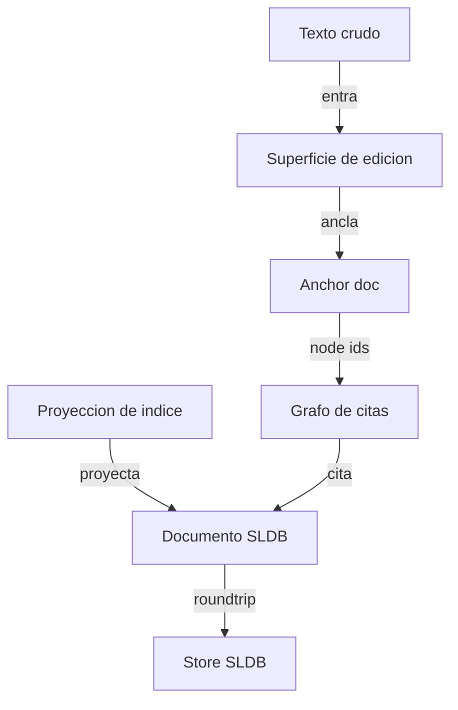

# Propuesta: superficie de anclaje y proyección sobre SLDB

Una superficie donde el texto crudo entra sin contrato, se le anclan símbolos
encima, y se proyecta a un documento SLDB estructurado cuyo grafo es la
superficie de citas.

No es un editor nuevo. Es el uso conjunto de cinco mecanismos que SLDB ya tiene,
más tres huecos que hay que cerrar.

## El flujo



Spec fuente: `examples/` de spec2viz, tipo `component`. Validado y linteado
(`diagram validate` → OK, `diagram lint` → OK).

## Los tres momentos

### 1. Texto crudo: el documento nace sin contrato

Modelo mínimo, ya sancionado en `docs/requests/sldb-pandoc-fenced-div-support.md`
(status: done):

```python
class ScratchDoc(StructuredNLDoc):
    __template__ = "# ⸢rev•title⸥\n\n⸢rev•body⸥"
```

`body` se traga markdown arbitrario y round-trippea. Ejemplo vivo en
`src/sldb/examples/pandoc_cv/`.

### 2. Anclaje: el texto gana referentes sin ganar estructura

`AnchorDoc` (`src/sldb/models/anchor_doc.py`) ya modela exactamente esto:

| Campo | Contenido |
|---|---|
| `symbol` | el término anclado en el texto |
| `kind` | `model` \| `doc` \| `relation` \| `operation` \| `projection` \| `expr` |
| `ref` | `model:<Name>` \| `doc:<name>` \| `edge:<rel>[:dir]` \| `op:<fn>` \| `fields:<f1,f2>` \| `view:<name>` \| `expr:(<s-expr con huecos _>)` |
| `motive` | por qué, en lenguaje natural, auditable |

`anchor_targets()` (`store/edge_index/anchor_targets.py`) resuelve ese `ref` a
node ids reales (`sldb://model/...`, `sldb://field/Model.campo`,
`sldb://relation_type/...`). Anclar produce aristas, no metadata muerta.

El `ref` admite dos gramáticas: el esquema `kind:rest` y la forma s-expression de
pron spec 13, leída por `store/edge_index/ref_form.py`. `kind: expr` es una
relación derivada con huecos `_`.

### 3. Proyección: el resumen es una vista declarada, no una copia

`IndexProjection` (`api/corpus/index_projection.py`) es el contrato:

```python
IndexProjection.of(
    models={"DomainAtom", "RuleAtom"},   # qué entra
    text=fields_text("summary", "body"), # cómo se lee
    text_id="resumen-cobranza",          # identidad de la lectura
)
```

La línea que cierra el diseño, textual del módulo:

> `text_id` nombra el mapeo **para que un cambio de representación invalide el
> índice igual que un cambio de embedder**.

Una cita es una proyección versionada. Cambiar el criterio invalida las citas.
No hay citas huérfanas que sobrevivan a un cambio de lectura.

Respaldo arquitectónico: ADR `sldb-text-layer-vs-kgdb-graph-layer.md` §5 —
*"Export should be a projection, not a replacement."*

## Secciones anónimas reubicables

El caso de uso: escribir un bloque sin decidir dónde va, y decidirlo después con
ayuda de un agente.

### Lo que ya funciona

`optrev` da el campo declarado pero ausente. De `renderer_engine/base.py:31`:

> un valor `None` **borra la línea entera**; el documento queda byte-por-byte
> como si el campo nunca se hubiera declarado.

Condiciones duras:

- Solo dos formas califican: `key: ⸢optrev•key⸥` o `⸢optrev•key⸥` sola en su línea.
- Si comparte línea (celda, bullet, texto adyacente) no se borra: se sustituye
  por `""`, porque borrar la línea rompería la estructura.
- `[]` / `{}` no son `None`: sí renderizan. Solo `None` es ausencia.

`template_sections.py:31` ya automatiza la promoción: campo con default →
marcador `optrev`; y `marker_kind()` elige la forma según la anotación
(`rev` / `rev,list` / `rev,dict` / `rev,table`).

### El hueco

Auditado contra el árbol de trabajo:

- Una sección se direcciona por su path jerárquico de slugs (`graph_ops/extract.py`).
- `section_node_id(export_id, section_path)` usa ese path posicional.
- No existe id de sección independiente de posición y título: `grep -rn "uuid"
  src/sldb` = 0 hits; `SectionRecord` solo tiene `title`, `slug`, `level`,
  `path`, `line_start`, `line_end`.
- Títulos repetidos se desambiguan con sufijo numérico por **orden de
  aparición** (`_unique_slug`, `extract.py:49-55`). Caso real: dos `## Notas`
  producen `doc/notas` y `doc/notas-2`.

Consecuencia: mover una sección cambia su dirección. Una sección anónima no
tiene título, luego no tiene dirección.

Ya está declarado como gap abierto en `documentation-review.md` §Structural CLI
Coverage:

> *"Repeated equal headings still need a stable, non-positional address design;
> the current hierarchical slug path is not sufficient for that case."*

### El agente que propone destino

Una vez exista el id estable, el agente no decide: rankea y ofrece.

- `Corpus.rank()` con una `IndexProjection` → a qué documento se parece el bloque.
- `context_index` con `breadcrumbs` y `about` → a qué sección se parece.
- `sections find --where '"term" in about'` → candidatos filtrables.

Sin embedder, `Matcher` cae a `difflib` (`api/matching/matcher.py:42-43`): la
propuesta funciona sin infraestructura externa, peor pero funciona.

## Estado verificado de cada pieza

| Pieza | Módulo | Estado |
|---|---|---|
| Texto crudo round-trip | `examples/pandoc_cv/` | ✅ funciona |
| `optrev` borra línea | `renderer_engine/base.py:31` | ✅ funciona |
| Promoción campo→sección | `model_drafts/template_sections.py` | ✅ funciona |
| Creación de modelos por API | `api/model_create/create_model.py` | ✅ funciona |
| `AnchorDoc` contrato | `models/anchor_doc.py` | ✅ existe |
| `anchor_targets` → node ids | `store/edge_index/anchor_targets.py` | ✅ código vivo |
| Anchors con aristas reales | `.sldb/runtime/edges/` | ❌ **0 AnchorDoc trackeados, 0 nodos `sldb://anchor/`** |
| `IndexProjection` | `api/corpus/index_projection.py` | ✅ existe |
| `Corpus.rank()` desde CLI | `api/corpus/corpus.py:68` | ❌ **no alcanzable: `find` usa `search_records`, no `Corpus`** |
| Composición anclada a raíz | `models/structured_doc.py` | ✅ **corregido, ver abajo** |
| Id estable de sección | — | ❌ **no existe** |
| `sections move` | `cli/commands/sections*` | ❌ **subcomandos reales: `show`, `find`, `fields`** |
| Cuerpo completo de sección | `sections_common.py:8-13` | ❌ **solo metadata, sin key `body`** |

## Lo ya corregido en esta ronda

Rama `fix/composition-anchoring` (worktree `sldb-wt-composition`).

Dos defectos de `__compositions__` documentados en `documentation-review.md`
§Composition:

**1. Anclaje de paths.** `compose_field` resolvía los paths hijos contra el cwd
del proceso. Ahora acepta una raíz de proyecto (`__composition_root__` declarativo,
o `_composition_root` por instancia, que gana). Sin raíz, se conserva el
comportamiento histórico relativo al cwd.

`render_model_markdown()` recibe `root=` y lo propaga; `render_document_markdown`
pasa `store_path.parent`, `create_document` pasa `location.project_root`.

**2. Hijos rotos en silencio.** El `except Exception` que devolvía `""` ahora
distingue cuatro casos, reportados en `composition_issues` sin alterar el
markdown renderizado:

- `missing child` — el path no existe
- `invalid child payload` — la extracción falló
- `empty child payload` — extrajo vacío
- `template error` — el `format()` falló

Verificación: `python3 -m pytest tests/ -q` → **1059 passed**, corrido en
primera persona, no reportado por el worker.

## Los tres huecos que faltan, en orden

### H1. Identidad estable de sección

Bloquea todo lo anónimo y reubicable. Requiere decidir: dónde vive el id (¿en el
markdown? ¿en el índice?), cómo sobrevive a un `git merge`, y cómo se reconcilia
si dos ramas crean la misma sección.

Es un problema de diseño, no de implementación. No lo despaches a un worker.

### H2. Composición por query

Hoy `source_field` es una **lista explícita de paths**. Un "resumen de una serie
de documentos" seleccionada por criterio no existe: composición seccional y
query-driven siguen siendo propuestas históricas en `composition_modes.md`.

Prerrequisito cumplido: el anclaje de paths ya está arreglado.

### H3. `Corpus.rank()` sin CLI

El ranking existe y funciona, pero solo desde Python. La superficie no puede
pedir candidatos sin exponerlo. Es el hueco más barato de los tres.

## Lo que la propuesta no promete

- **Edit-through**: `composition_modes.md` es explícito — *"There is no
  implemented edit-through operation from a summary to its child document."* El
  resumen navega hacia los fuentes; no los edita. Eso no es limitación de UI: es
  el contrato.
- **`⸢py•expr⸥`**: solo evalúa con `python_execution_mode == "unsafe"`. Por
  defecto devuelve el fallback. No usable en superficie multiusuario.
- **`surface` lossless**: el IR no serializa todo atributo del parser. No lo
  trates como fuente de verdad del texto.

## Regla de diseño que sale sola

**Lo `rev` se edita. Lo `render` se navega.**

La superficie pinta esos dos tipos de bloque distinto, y "qué es editable" deja
de ser una decisión de UI para ser una lectura del contrato del modelo.
