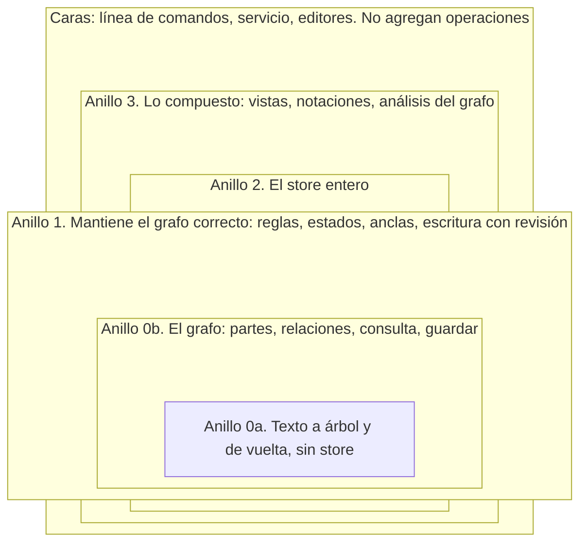

# Mecanismo: los anillos

Clase de página: mecanismo. Fecha: 2026-11-27. Estado: reparto confirmado por JP el 2026-11-27
("demosle").

Cada anillo contiene a los de adentro y solo depende de ellos. El diagrama se genera de
`diagramas/component.anillos.yml`; no se edita a mano.

## Regla

Cada anillo importa solo de los de adentro. Las caras llaman a la operación completa (revisar y
escribir), nunca a la escritura sola.

## Reparto

Los nombres de eje son los de `contracts/layers.toml`.

| Anillo | Qué es | Qué entra |
|---|---|---|
| 0a | Texto y árbol, sin store | texto a árbol, nodos de significado y superficie, árbol a texto, lectura de fuentes, lectura de código, errores |
| 0b | El grafo: nodos, cosas adentro, relaciones; los cuatro verbos y la navegación | modelos como declaración, persistencia, codec, identidad y hash como propiedad del nodo, derivar relaciones (índice de aristas, enlaces del texto, DAG de tags), caché, consulta con el lenguaje de predicados, operaciones de documentos, modelos y aristas |
| 1 | Lo que mantiene el grafo correcto | validar contra el modelo, reglas, máquina de estados, detección de mutaciones, anclas (a texto, a código y a un resultado ejecutado), procedencia y política, bitácora y deshacer |
| 2 | El store entero | abrir y diagnosticar, refrescar, migración, catálogo y federación |
| 3 | Lo compuesto | vistas, notaciones, composición de texto, análisis del grafo, similitud y corpus, selfdoc |
| caras | No agregan operaciones | CLI, MCP, HTTP, adaptadores; los avisos de cambio (hooks de git, daemon) |

## Módulos del sistema que queremos, por anillo

> Esta tabla se hizo sin mirar el código. La lectura de los dos códigos, con los módulos de
> verdad, está en [`modulos.md`](modulos.md).

Los anillos ordenan módulos: qué módulo puede usar a cuál. Esta tabla toma la lista de módulos
que dio JP el 2026-11-27 y los ubica. Es propuesta del agente, sin revisar. El reparto de más
arriba es otro: ubica los 32 ejes del código de hoy.

| Anillo | Módulo | Qué tiene adentro |
|---|---|---|
| 0a | AST | Leer una fuente como árbol. Uno por tipo de fuente, todos iguales en importancia: documento (lo que hoy son modelos), código (hoy tree-sitter), datos, texto libre. |
| 0a | Lectura y escritura | De la fuente al árbol y del árbol a la fuente, por tipo de fuente. |
| 0b | Base de datos | El grafo guardado: nodos, relaciones y hechos. Con kimun, Datalevin. |
| 0b | Lenguaje de consultas | Preguntar y filtrar. Es el de la base de datos. |
| 0b | Condicionales | Decir "si pasa esto". Usa el lenguaje de consultas. |
| 1 | Anclaje | Atar un nodo a una parte de una fuente y notar que cambió. Usa AST y base de datos. |
| 1 | Hooks | Hacer algo cuando algo ocurre. |
| 1 | Máquinas de estado | Estados y pasos permitidos. Usa hooks y condicionales. |
| 2 | git | Historia y cambio a nivel de archivo. |
| 3 | Clases | Nombres para lo que comparte forma o papel, por tipo de fuente. |
| 3 | Estructuras lingüísticas o de documento | Formas conocidas de textos. |
| 3 | Estructuras semánticas | Formas conocidas de significado. |
| 3 | Patrones de código | Formas conocidas en código. |
| caras | Línea de comandos, API, MCP, REPL | Por dónde se le habla. |
| afuera | Librerías | Lo que antes se llamó plugins. Usan todo lo anterior. |

Dudas de ubicación:

- **Base de datos en el 0b.** En el reparto de hoy la persistencia está en el 0b y "el store
  entero" en el 2. Si el lenguaje de consultas es el de la base de datos, las dos van juntas en
  el 0b.
- **Clases.** JP las listó junto a anclaje, AST y lectura, por tipo de documento. Aquí están en
  el 3 porque se declaran encima. Si son parte de cómo se lee cada tipo de fuente, bajan al 0a.
- **git en el 2.** Si el anclaje lo usa para saber que un archivo cambió, baja al 1 o antes.
- **Anillo 2.** Quedó con un solo módulo. Puede que sobre.

## Lo que lo sostiene (JP, 2026-11-26 y 27)

- Un documento no necesita modelo para existir. El anillo 0 trabaja con cualquier fuente como
  árbol, Markdown o código, y puede escribirla.
- Una fuente puede cambiar sin pasar por sldb. Por eso la lógica es una sola: se ve un cambio y
  el anillo 1 lo revisa. Cuando escribe sldb, la operación es revisar lo propuesto y escribir, y
  vive en el anillo 1.
- No todo documento se sigue completo. sldb sigue las partes elegidas; un nodo seguido puede
  llevar su contenido, además de sus hashes y relaciones (corregido el 2026-11-27: antes decía
  que no se guardaba contenido). El hash es la forma barata de notar un cambio.

## Persistencia y motor

- El anillo 0b tiene una sola puerta de persistencia y una sola puerta de grafo. Hoy no existen
  como tales.
- Lo que la persistencia guarda primero es lo propio de sldb: nodos seguidos, hashes, anclajes y
  relaciones. También tiene que poder guardar documentos enteros, por nodos, aunque no es su
  primera función (JP, 2026-11-27). Tiene que poder correr sobre Postgres en el corto plazo (JP).
- Para el grafo se adopta un motor externo sin esperar (JP). Cuál: abierto; la propuesta
  anterior (Cozo con sqlite) no consideraba Postgres.

## Abierto

- Qué motor de grafo. JP se inclina por Postgres: para varios proyectos permite Supabase con
  filtrado por RLS. Sin cerrar.
- El árbol es el árbol de Merkle de los hashes: la forma barata de detectar mutaciones (JP).
- El diseño del ancla a un resultado ejecutado.
