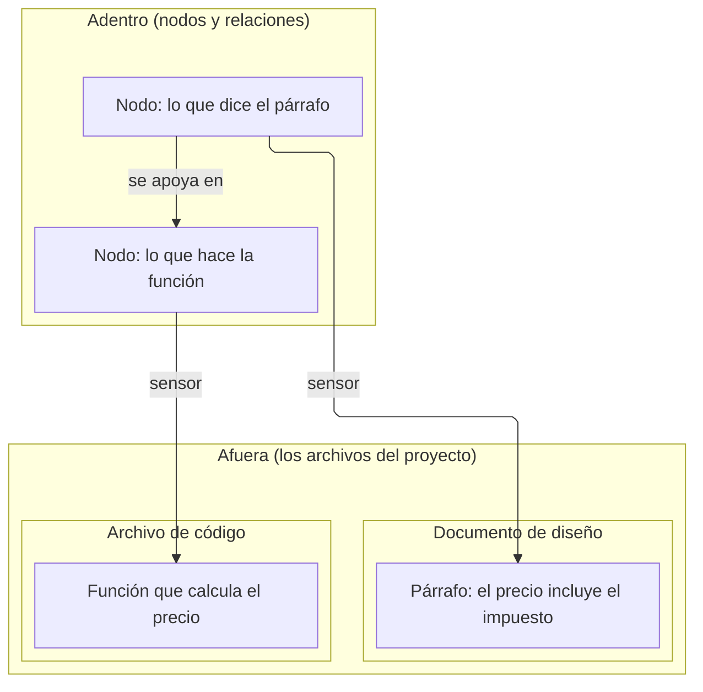

# sldb

Borrador, sin aprobar. Este texto declara qué es sldb como sistema. Es el segundo de tres
niveles: antes están los fundamentos (`fundamentos.md`: de dónde viene la idea y sus
principios); después, las técnicas, capacidades y estructuras de datos, que son el resto del
spec. No describe cómo está construido ni en qué estado está.

## El problema

Lo que un proyecto sabe está escrito en sus archivos. Hay documentos que explican decisiones,
código que las ejecuta, tareas que dicen qué falta. Y esos archivos hablan unos de otros: un
documento de diseño afirma algo sobre una función, una tarea existe por una decisión, una
decisión se apoya en un párrafo de otro documento.

Ese conocimiento existe, pero no está en ninguna parte donde se lo pueda usar. No se le puede
preguntar al proyecto qué depende de una función, ni qué decisiones quedaron sin revisar. Y
cuando un archivo cambia, nada sabe qué otras cosas hablaban de él.

Además no todo lo escrito es igual. Hay documentos que siguen una forma conocida y hay texto
libre, y lo habitual es tratarlos como lo mismo: o todo son formularios, o todo es prosa.

## Qué es sldb

sldb es un grafo de lo que un proyecto sabe, construido desde sus archivos y conectado a ellos.

Tiene un adentro y un afuera. Adentro hay nodos y relaciones. Afuera están los archivos, que
siguen siendo archivos comunes. Lo que une las dos cosas son sensores: puntos donde un nodo de
adentro está atado a una parte de un archivo, y por donde se entera de que esa parte cambió.

El grafo no es la realidad del proyecto ni reemplaza a sus textos. Los textos y el grafo dicen
lo mismo, los hechos del proyecto, cada uno con sus reglas. El grafo es la forma sobre la que
sldb opera: ahí se nombra, se enlaza y se consulta.

Lo que se hace con sldb se hace adentro: preguntar, relacionar, comprobar, cambiar. Y lo que hay
adentro se puede volver a sacar, como el mismo archivo del que salió o de otra forma.

El resto de este texto recorre eso en orden: qué hay adentro, cómo se toca con el afuera, cómo
entra y sale algo, cómo aparecen los tipos, y qué pasa cuando el afuera se mueve. Se usa un solo
ejemplo: un proyecto con una función que calcula un precio, y un documento de diseño con un
párrafo que dice "el precio incluye el impuesto".

## Adentro

Adentro hay nodos y relaciones entre nodos, y nada más. Un nodo es una cosa de la que se sabe
algo: lo que dice un párrafo, lo que hace una función, una tarea, una decisión. Una relación une
dos nodos y tiene un tipo: este párrafo se apoya en esta función, esta sección contiene a este
párrafo, esta tarea responde a esta decisión. Sobre nodos y relaciones hay hechos: quién declaró
esto, cuándo se vio aquello, que tal cosa cambió.

Un nodo puede llevar cosas adentro, y esas cosas también pueden tener relaciones. Lo que el
párrafo dice está en su nodo.

Todo lo que sldb maneja se expresa así. Una regla del proyecto, un modelo de documento, una vista
para mostrar algo: son nodos y relaciones, igual que el párrafo. No hay una segunda clase de
objetos para "la configuración".

Lo importante de un nodo no es el nodo: son sus relaciones. Y esta red, la de nodos y relaciones,
es lo único que tiene identidad propia. Un nodo es ese nodo y lo sigue siendo, pase lo que pase
afuera.

El grafo no se mira entero. Se consulta. Lo que importa es que cada pregunta tenga una respuesta
clara: qué se sabe, en qué se apoya y qué tan firme está.

## Afuera, y los sensores

Los archivos del proyecto están afuera. No son parte del grafo, y un archivo o un pedazo de
archivo no tiene identidad para sldb. Afuera las cosas se mueven, se renombran y desaparecen sin
pedir permiso, y eso es normal.

Lo que sldb sabe del afuera lo sabe por sensores. Cuando alguien marca una parte de un archivo,
nace adentro un nodo atado a ella. El nodo recuerda qué vio, es decir el contenido de la parte y
una huella, que es una marca corta que cambia si el contenido cambia; y recuerda dónde lo vio.
Eso es un ancla.

sldb siente del afuera solo lo que tiene sensor. No hace falta sensorizar un archivo entero: se
marca la función, el párrafo o el valor que importa. Del resto, a nivel de archivo, ya se ocupa
el control de versiones.

De aquí sale qué quiere decir "la misma parte". Una parte sin marcar no tiene continuidad ni la
necesita: se la nombra por dónde está, y si se mueve, ese lugar nombra lo que haya ahí ahora. Lo
que persiste es el nodo. Si la función cambia de lugar, lo que se actualiza es el "dónde" de su
nodo.

Un ancla no es un enlace. Un enlace dice "esto se refiere a aquello" y sigue funcionando aunque
aquello ya diga otra cosa. Un ancla recuerda qué decía, y por eso puede notar que cambió.

## Entrar y volver a salir

Entrar tiene etapas.

Primero se ancla. Cada parte que alguien marca da un nodo de anclaje: recuerda dónde estaba la
parte y qué se vio. Un anclaje crea ese nodo y nada más.

Después se junta. Distintas fuentes suelen decir lo mismo. Si tres anclajes traen la misma
afirmación, se reúnen en un "las fuentes dicen".

Y de ahí se sintetiza. De lo que las fuentes dicen se arma el árbol de conocimiento, con nodos
de significado. Un nodo de significado es una afirmación, una sola, por muchos lugares en que
esté escrita.

Sirve un ejemplo distinto del precio. Una empresa tiene un manual interno, una página web y las
instrucciones de un asistente que atiende por mensajería. Los tres dicen cuál es el plazo de
devolución, y tienen que decir lo mismo. El manual es la fuente y los otros dos se derivan de
él. Con los tres anclados y juntos en un solo nodo de significado, cuando el plazo cambia se
sabe de inmediato en qué tres lugares está escrito, sin leer ningún documento.

Salir es proyectar. Lo que está adentro se saca de muchas formas, y cada una es una proyección
con sus reglas: una ficha, una fila de una tabla, una caja de un diagrama, un tablero. Un texto
derivado de otro es eso: una proyección del mismo conocimiento. Una de las proyecciones es
especial: sacar los nodos por la misma estructura que el documento tenía cuando entró. Esa
devuelve el documento tal como estaba. Un documento marcado por completo vive adentro, y por
esa proyección se lo recupera entero o por secciones.

Por ahí se edita. Se cambia el nodo y se proyecta de nuevo a su archivo, sin tocar el resto.

Editar tiene una regla. Sobre lo que se observó manda el archivo; sobre las consecuencias manda
la red. Un cambio se aplica sobre la versión que se vio. Si mientras tanto alguien tocó otra
parte del archivo, eso se conserva. Si tocó la misma, hay un choque, y se muestra.

Así que hay tres clases de nodo, distintas y enlazadas: el de anclaje, que es dónde estaba algo
afuera; el de significado, que es lo que se sabe; y el de proyección, que es una forma de
decirlo. Se pregunta por lo que se sabe. Se detecta el cambio en el anclaje. Y lo que se
muestra se genera: no se escribe dos veces.

## Familias

Mucho de lo que se escribe en un proyecto tiene una forma más o menos fija: un reporte, un
formulario, una decisión, una tarea. Y mucho otro es texto libre. sldb no parte de los tipos para
decidir qué acepta. Parte de lo que entró y mira qué comparte.

**Por la forma.** Si varios documentos entraron con exactamente la misma estructura, hay un
modelo en común: "esto es un reporte de tal clase". El modelo no se les impuso; es el nombre de
lo que ya compartían. Sirve hacia los dos lados: dice qué tomar al entrar y cómo proyectar al
salir. Si otros documentos son iguales salvo por una parte de más, son una variación de ese
modelo. Y con eso aparece lo conocido: una variación hereda de su modelo, documentos distintos
se tratan como el mismo en lo que comparten, un modelo se arma juntando otros. Herencia, clases,
polimorfismo y composición no son algo que sldb agregue. Son lo que resulta de especializar.

Un documento sin modelo propio no queda fuera. Está en la clase más general, la de ser un árbol
de partes. Lo que no calza con un modelo no se fuerza: se especializa.

**Por lo que es.** Un nodo puede llevar además un tipo por lo que significa, por el papel que
cumple en el texto o por para qué sirve: esto es un diagnóstico, esto es una conclusión, esto es
un requisito. Sobre esos tipos se arma otra jerarquía. Un reporte de epicrisis y un reporte de
rendimiento son los dos reportes aunque por fuera no se parezcan.

Las dos jerarquías no coinciden. Dos documentos pueden tener la misma forma y ser cosas
distintas, o ser lo mismo con formas distintas. Por eso van separadas: unas relaciones son de
estructura y otras de significado.

Con esto se puede tratar distinto lo que es distinto. Donde hay forma estándar hay un modelo, y
con él se comprueba y se proyecta. Donde no la hay, quedan los nodos y lo que se diga de ellos, y
eso también se consulta y se relaciona.

## Cuando el afuera se mueve

Lo que hay adentro se construyó desde los archivos, y dice cosas ciertas sobre ellos mientras no
cambien. Cuando uno cambia, el sensor lo nota y queda declarado que hubo un cambio.

Ese cambio entra por el ancla y baja por las relaciones. Alguien edita la función del precio: su
nodo ya no coincide con lo que hay afuera. El párrafo se apoyaba en ese nodo, así que el párrafo
queda en duda. Y lo que se apoyaba en el párrafo, también.

Pero un cambio no se lleva todo. Algunos nodos quedan sin ningún apoyo. Otros se sostienen por
otro lado: el párrafo se apoyaba además en una prueba, y la prueba sigue igual. Y la mayor parte
del grafo no tiene ningún camino desde la función y no se entera.

Por eso lo que se sabe no está simplemente vigente o caído. Hay zonas firmes y zonas movidas. De
una zona se puede decir cuánta certeza tiene y cuánto desorden acumuló, y es en las movidas
donde aparecen las contradicciones y los errores.

sldb no decide si el párrafo sigue siendo cierto. Quizá solo ordenaron el código y el impuesto
sigue incluido. Eso lo ve quien revisa, y lo resuelve anclando de nuevo; queda quién lo hizo. Lo
mismo si a la función le cambiaron el nombre: sldb no sale a buscar cuál es ahora. Reconectar no
es algo que el sistema persiga, es lo que resulta de un anclaje nuevo.

Y adentro no se borra. Si borran la función, queda declarado que ya no está, su nodo sigue con
ese hecho encima, y la consecuencia baja como cualquier otro cambio. Quitar de verdad los nodos
que quedaron sin apoyo es una limpieza aparte, posterior y pedida. Afuera las cosas sí
desaparecen, pero eso solo llega adentro por sus anclas.

## Lo que resulta

Varias cosas que suelen escribirse como reglas salen solas de lo anterior.

Si lo de adentro se tomó de afuera, manda afuera. El contenido que guarda un nodo es una
observación, y una observación puede estar vieja. Cuando difieren, vale el archivo. Por lo mismo,
lo que sldb calcula a partir de lo que tiene, un índice o una respuesta, no vale por sí mismo: se
puede borrar y rehacer. Lo que no se puede rehacer es lo que alguien declaró, y eso no puede
quedar guardado junto con lo que se borra.

Si el grafo se consulta para saber qué tan firme está algo, preguntar no puede cambiar la
respuesta, y una respuesta no puede esconder lo que no sabe. "No hay nada" y "no pude mirar" son
respuestas distintas.

Si una regla del proyecto es un nodo como cualquier otro, se la puede leer, relacionar y
comprobar igual que al párrafo. Y si es del grafo y no de una de sus entradas, vale lo mismo por
cualquier puerta por donde se pida un cambio.

Si el sentido de un nodo está en sus relaciones, no está en su nombre. Que dos proyectos usen la
palabra "precio" no los hace hablar de lo mismo. Decir que sí es una relación que alguien
declara, una persona o un agente, y queda quién fue. Un parecido que encuentra una máquina es una
sugerencia hasta que alguien lo declara.

Y si los tipos salen de lo que entró, sldb no trae ninguno. No sabe qué es una tarea ni una
decisión ni un diagrama de cierta norma. Eso lo declara cada proyecto, con los mismos nodos y
relaciones.

## Para qué se usa

Tres usos, todos declarados encima de sldb por quien lo usa:

- **Llevar el trabajo de un equipo.** Cada tarea es un documento. El equipo declara qué campos
  tiene una tarea, por qué estados pasa y qué reglas cumple. El tablero se genera.
- **Describir un sistema y dibujarlo.** Los componentes y sus conexiones se declaran como nodos
  y relaciones. Una vista elige qué mostrar y una notación dice con qué figura. sldb entrega la
  vista resuelta; la dibuja otro programa.
- **Mantener al día lo que se dice del código.** Es el ejemplo de arriba.

Lo usan personas y agentes sobre un mismo proyecto. Para un agente es la forma de saber en qué se
apoya lo que otro escribió, sin tener que creerle.

## Lo que sldb no es

- No reemplaza a los archivos. Aunque un documento esté entero adentro, su archivo sigue siendo
  un archivo común, y si difieren manda el archivo.
- No es un control de versiones. Ese dice qué líneas cambiaron; sldb dice qué dependía de ellas.
- No es un buscador. Un buscador encuentra palabras parecidas; sldb responde por relaciones.
- No es un generador de documentación. Genera, pero como consecuencia de saber, no como fin.
- No es un juez. Dice si lo que sabe es consistente y qué tan firme está, no si es cierto.

## Lo que falta decidir

Hay cosas que este texto usa y no resuelve.

1. **Las etapas de un cambio.** Detectar, declarar el cambio, bajar la consecuencia, revisar,
   limpiar. Cuántas corren solas y cuáles esperan a alguien puede variar; lo que falta fijar es
   el mínimo con que esto ya sirve.
2. **Cómo se mide la certeza.** Que hay zonas más firmes y zonas más movidas está dicho. Con qué
   se mide también puede variar; falta fijar el mínimo.
3. **Qué es un hook.** Una afirmación puede apoyarse en un resultado ("la prueba pasa"), un
   estado puede cambiar cuando algo ocurre, un cambio puede disparar una revisión. En los tres
   casos algo se ejecuta. Falta decir qué es un hook, con qué mecanismos funciona, qué
   condiciones tiene que pasar antes de correr, y cómo se mete a una persona en el medio sin que
   usarlo se vuelva una carga. Dónde y cómo corre lo define cada hook.
