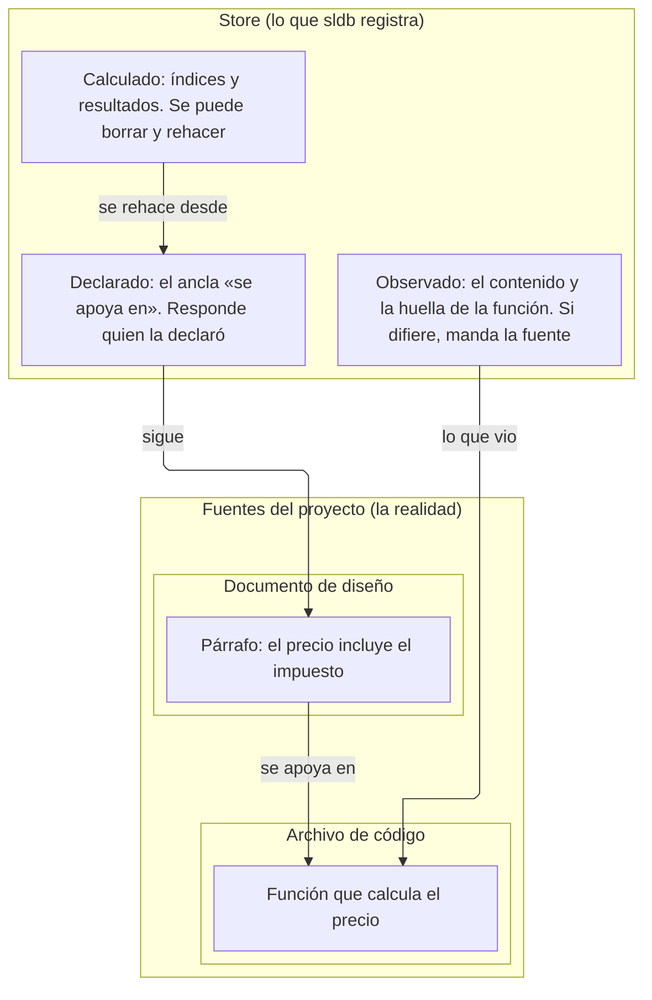

# sldb

Borrador, sin aprobar. Este texto explica qué es sldb y por qué es así. No describe cómo está
construido ni en qué estado está.

## El problema

Lo que un proyecto sabe está escrito en sus archivos. Hay documentos que explican decisiones,
código que las ejecuta, tareas que dicen qué falta. Y esos archivos hablan unos de otros: un
documento de diseño afirma algo sobre una función, una tarea existe por una decisión, una
decisión se apoya en un párrafo de otro documento.

Nada de eso se puede usar. No se le puede preguntar al proyecto qué depende de una función, ni
qué decisiones quedaron sin revisar, ni si todas las tareas cumplen lo que el equipo acordó. Y
cuando un archivo cambia, nada avisa a los que hablaban de él. El párrafo que describía la
función sigue ahí, escrito igual, y ya nadie sabe si describe lo que la función hace.

La salida de siempre es llevar ese conocimiento a una base de datos y trabajar ahí. Funciona un
tiempo. Después hay dos versiones de cada cosa, la del archivo y la de la base, y cada una dice
algo distinto. Quien quiere saber la verdad tiene que mirar las dos.

## La idea

Un archivo con estructura ya es dato.

Un documento tiene secciones, campos, listas. Un archivo de código tiene funciones y clases. La
interfaz de un programa tiene comandos y parámetros. Esa estructura se puede leer siempre igual,
sin interpretar nada. Entonces no hace falta copiar el conocimiento a otro lado para tratarlo
como dato: basta leerlo donde está.

sldb es eso. Lee la estructura de los archivos de un proyecto y permite trabajar sobre sus
partes como se trabaja con datos: nombrarlas, relacionarlas, consultarlas, comprobarlas,
cambiarlas. Los archivos siguen siendo archivos comunes, y siguen siendo la verdad.

Todo lo demás de este texto sale de tomarse en serio esa frase.

## El modelo

**Fuentes y partes.** Una fuente es un archivo del proyecto. Una parte es una unidad de su
estructura: una sección, un párrafo, un valor, una función. Para sldb un documento y un archivo
de código son lo mismo, un árbol de partes. Eso es lo que permite que un párrafo y una función se
relacionen: son la misma clase de cosa.

No hace falta seguir un archivo entero. Se elige qué partes importan, y el resto queda en su
archivo sin que sldb tenga nada que decir. Tampoco hace falta que la fuente se adapte: sldb mira,
no exige.

**Adentro y afuera.** Los archivos están afuera. Adentro de sldb hay solo nodos y relaciones:
objetos, vínculos y hechos. Esa es la topología propia del sistema, y solo lo que está en ella
tiene identidad. Un archivo, o un pedazo de archivo que nadie marcó, no es parte de ella.

Lo que une las dos cosas es un sensor. Cuando alguien marca una parte de una fuente, nace
adentro un nodo que la sigue: recuerda qué marcó y dónde lo encontró. sldb siente del exterior
solo lo que tiene sensor. El resto del proyecto está cubierto, archivo por archivo, por el
control de versiones, y con eso basta.

De ahí sale qué significa "la misma parte". Una parte sin marcar no tiene continuidad ni la
necesita: se nombra por su dirección, y si se mueve o se reordena, esa dirección nombra lo que
haya ahora en ese lugar. Lo que persiste es el nodo que la marcó. Si la parte cambia de lugar o
de nombre, lo que se actualiza es el "dónde" de ese nodo. El exterior puede alterar lo de
adentro, porque un sensor nota el cambio, pero no pasa a ser parte de adentro.

**Relaciones.** Entre los nodos hay relaciones, y cada relación tiene un tipo: esta sección
contiene a este párrafo, este párrafo se apoya en esta función, esta tarea responde a esta
decisión. Algunas salen de la estructura misma, como "contiene". Otras las declara alguien, una
persona o un agente, y queda escrito quién fue.

Con partes y relaciones se arma un grafo, y sldb no tiene nada más que eso. Un modelo, una regla
o una vista también se expresan como partes y relaciones. Lo importante de una parte no es ella
misma: son sus relaciones.

**Entrar y volver a salir.** Marcar una parte la hace entrar: lo que dice pasa a ser un nodo
de adentro. Se puede marcar poco o mucho. Un documento marcado por completo vive adentro, como
los nodos que se tomaron de él.

Lo que está adentro se puede volver a mostrar de muchas formas, y cada forma es una proyección.
Una de ellas es especial: proyectar por la misma estructura que el documento tenía al entrar.
Esa proyección devuelve el documento tal como estaba. Por ahí se recupera una sección, y por
ahí se la modifica: se cambia el nodo y se proyecta de nuevo a su archivo.

Entonces hay tres cosas que conviene no mezclar: dónde estaba una parte en su fuente (su
anclaje), qué dice (su significado), y cómo se muestra (una proyección). Las preguntas se hacen
sobre lo que dice. Los cambios se detectan en donde estaba. Y lo que se muestra se genera.

Un modelo es eso mismo visto desde una familia de documentos. Cuando varios comparten
estructura, esa estructura se declara una vez, y sirve para las dos cosas: para saber qué partes
tomar al entrar y para proyectarlos al salir. Por eso un modelo no es requisito para leer una
fuente: es lo que se obtiene cuando varias se parecen.

**El store.** Lo que sldb registra de un proyecto se llama store. No es una copia del proyecto.
Tiene tres clases de cosas y cada una vale distinto:

- lo que alguien declaró y ningún archivo dice por sí solo: una relación, una regla. Vale lo
  que vale quien lo declaró;
- lo que sldb observó de una parte en un momento: su contenido y una huella, que es una marca
  corta que cambia si lo observado cambia. Vale mientras coincida con la fuente; si difieren,
  manda la fuente;
- lo que sldb calculó a partir de lo anterior: índices, respuestas. No vale por sí mismo; se
  puede borrar y rehacer.

## Un ejemplo, de principio a fin

Un proyecto tiene una función que calcula un precio, y un documento de diseño con un párrafo que
dice: "el precio incluye el impuesto".

Alguien declara que el párrafo se apoya en la función. Con eso nacen adentro dos nodos, uno que
sigue al párrafo y otro que sigue a la función, y una relación entre ellos. Esa relación es un
ancla: además de unirlos, recuerda lo que vio de la función en ese momento.

Desde ahí se puede preguntar. Qué dice el párrafo. En qué se apoya. Qué otras cosas del proyecto
se apoyan en esa misma función. Si hay algún documento de diseño que no se apoya en nada.

Una semana después alguien cambia la función, con el editor que quiera. sldb no estaba mirando
y no importa: la próxima vez que se le pregunte, compara la huella que guardó con la función de
ahora, ve que difieren, y muestra el párrafo como pendiente de revisión. No dice que el párrafo
esté mal. Quizá solo ordenaron el código y el impuesto sigue incluido. Eso lo decide quien
revisa; cuando lo confirma, el ancla toma la huella nueva y queda quién lo confirmó.

Si en vez de cambiarla la borran, el párrafo no se borra con ella ni se impide el borrado. El
párrafo queda, marcado como sin soporte.

Y si el equipo decidió que todo documento de diseño tiene que apoyarse en algo del código, eso
no se programa: se declara como una regla, igual que se declaró el ancla, y sldb la comprueba
cada vez que alguien intenta escribir.

## Lo que se sigue de la idea

Si los archivos son el dato, varias cosas dejan de ser opcionales.

**Un cambio viaja.** Como el documento está sensorizado, se sabe qué parte cambió. Y como
adentro todo son relaciones, se sabe qué nodos tienen un camino desde esa parte. Esos son los
que hay que actualizar o revisar, y es ahí donde aparecen las contradicciones y los errores: un
párrafo que ya no calza con su función, una regla que dejó de cumplirse.

**Manda la fuente.** sldb puede tener el contenido de lo que sigue, y lo necesita para responder
y para generar. Pero es una observación, y una observación puede estar vieja. Por eso las fuentes
pueden cambiar por fuera de sldb sin que eso sea un daño: es un cambio que hay que ver. Y por eso
todo lo calculado se tiene que poder borrar sin perder nada. Si al borrarlo se pierde algo, eso
no era un cálculo: era algo que alguien declaró y quedó guardado en el lugar equivocado.

**Apoyarse no es apuntar.** Un enlace que solo dice "esto se refiere a aquello" sigue funcionando
aunque aquello haya cambiado por completo. Lo que hace falta saber no es si el destino existe,
sino si dice lo mismo que cuando se lo citó. Para eso el ancla guarda lo que vio. La huella sirve
para notar el cambio y para nada más: no dice qué significa una parte, ni que dos partes sean
iguales, ni es el nombre de la parte.

**Nada se pierde ni se oculta.** El valor de sldb está en que se pueda confiar en lo que muestra.
Si borrar una cosa se lleva en silencio otras que dependían de ella, o si una respuesta vacía
puede significar tanto "no hay nada" como "no pude mirar", esa confianza se acaba. Así que nunca
se pierde un dato que nadie pidió perder, y lo que no se sabe se dice que no se sabe.

**Preguntar no cambia nada.** Una consulta no modifica lo registrado ni lo arregla por su
cuenta. Si lo hiciera, dos que preguntan lo mismo verían cosas distintas.

**Las mismas reglas por cualquier puerta.** Un cambio pedido a sldb se propone, se comprueba, y
solo si pasa se escribe en el archivo. Da lo mismo por dónde se pidió. Si una entrada comprueba y
otra no, la regla es un adorno.

**Lo que se genera no se escribe a mano.** Desde lo que sldb sabe se pueden generar otras
expresiones: un tablero, una ficha, los datos de un diagrama. Lo generado remite a su origen.
Editarlo a mano, o escribir a mano lo que se pudo generar, es volver a tener dos versiones.

**El sentido es local.** Un nombre vale dentro de su store. Que dos proyectos usen la palabra
"precio" no significa que hablen de lo mismo. Decir que sí es una declaración que alguien hace, no
algo que se deduce de que las letras coincidan. Lo mismo vale para un parecido que encuentra una
máquina: es una sugerencia hasta que alguien la declara.

**sldb no sabe de qué trata el proyecto.** No sabe qué es una tarea, ni una decisión, ni un
diagrama de cierta norma. Sabe de partes, relaciones, modelos, reglas y vistas. Qué es una tarea
lo declara el proyecto que las usa, con esos mismos mecanismos. Un sldb que conociera a su primer
usuario dejaría de servirle al segundo.

## Para qué se usa

Tres usos, todos declarados encima de sldb por quien lo usa:

- **Llevar el trabajo de un equipo.** Cada tarea es un documento. El equipo declara qué campos
  tiene una tarea, por qué estados pasa y qué reglas cumple. El tablero se genera.
- **Describir un sistema y dibujarlo.** Los componentes y sus conexiones se declaran como partes
  y relaciones. Una vista elige qué mostrar y una notación dice con qué figura. sldb entrega la
  vista resuelta; la dibuja otro programa.
- **Mantener al día lo que se dice del código.** Es el ejemplo de arriba.

Lo usan personas y agentes sobre un mismo proyecto. Para un agente es la forma de saber en qué se
apoya lo que otro escribió, sin tener que creerle.

## Lo que sldb no es

- No es la base de datos donde viven los documentos. Los documentos viven en sus archivos.
- No es un control de versiones. Ese dice qué líneas cambiaron; sldb dice qué dependía de ellas.
- No es un buscador. Un buscador encuentra palabras parecidas; sldb responde por relaciones.
- No es un generador de documentación. Genera, pero como consecuencia de saber, no como fin.
- No es un juez. Dice si lo registrado es consistente y si su soporte cambió, no si es cierto.

## Lo que falta decidir

Hay cosas que este texto usa y no resuelve.

1. **Qué pasa cuando un borrado rompe una regla.** Borrar no se rechaza porque haya
   dependientes. Pero si ese borrado deja incumplida una regla del proyecto, las dos cosas
   chocan.
2. **Qué compromiso asume un modelo.** Si un documento con modelo trae una sección que el modelo
   no conoce, eso es un error o simplemente una parte que no se sigue. Y si una fuente sin
   modelo pertenece igual a alguna clase general.
3. **Cuánto decide sldb solo.** Si una función cambió de nombre y hay una sola candidata, sldb
   reconecta el ancla y avisa, o propone y espera.
4. **Quién ejecuta.** Una afirmación puede apoyarse en un resultado ("la prueba pasa"). Falta
   decir si sldb corre esa ejecución o solo ancla un resultado producido afuera.
